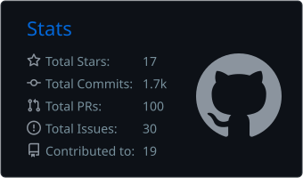
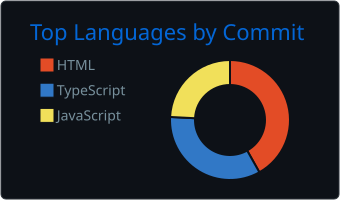
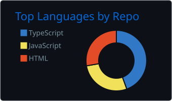

<!--
  This repo (mncoleman/mncoleman) is BOTH my GitHub profile README and the
  source for my website. Top half = about me. Bottom half = the website.
-->

<div align="center">

<a href="https://mncoleman.com">
  
</a>

<p>
  <a href="https://mncoleman.com"></a>
  <a href="https://www.linkedin.com/in/matthew-coleman-15a66b233/"></a>
  <a href="https://x.com/mncoleman_"></a>
  <a href="https://www.instagram.com/mncoleman_/"></a>
  
</p>

</div>

## About Me

> Welcome! I'm **Matthew Coleman**, and this is my small corner of the internet, where I collect my thoughts, projects, and experiences. I hope you enjoy your stay.

- Deeply passionate about **technology, AI, and the vast world of digital possibilities**
- I love **rapid development**, building and shipping real things fast, often with AI as a co-pilot (**Claude**)
- I share thoughts, experiences, and technical knowledge over at **[mncoleman.com](https://mncoleman.com)**
- Lately playing with **WebGL / 3D**, motion design, and **git-backed** content pipelines

### Tech I Reach For

<div align="center">
  
</div>

### GitHub Stats

<div align="center">

  

  <br />

  
  

  <br />

  

</div>

---

<div align="center">

# My Website

**This profile lives in the same repo that powers [mncoleman.com](https://mncoleman.com)**: a personal site with a blog, projects, resources, AI prompts and skills, hosted artifacts, a Bible reader, and a resume.

[](https://nextjs.org/)
[](https://www.typescriptlang.org/)
[](https://tailwindcss.com/)
[](https://pages.cloudflare.com/)

[Live Site](https://mncoleman.com) · [Report Bug](https://github.com/mncoleman/mncoleman/issues) · [Request Feature](https://github.com/mncoleman/mncoleman/issues)

</div>

---

## What it is

A statically exported Next.js site (`output: 'export'`) on a custom domain, hosted on **Cloudflare Pages**. Content is read at build time, so there is no runtime server for the site itself. Around it sit three small Cloudflare Workers and a Bun service that this repo also contains, each deployed on its own.

**Site features**

- Home page bento grid of 3D glass cubes (pure CSS transforms), with a Dark Veil WebGL backdrop in dark mode and a procedural paper-and-pencil canvas in light mode
- Blog, projects, resources, an AI library of prompts and skills, a hosted artifact gallery, a brand kit, and a resume page (print, save as PDF, share)
- Bible verse mentions: a verse link in a post renders as a hover card with KJV/WEB text baked in at build time, backed by a static `/bible` reader with cross-references
- `Cmd/Ctrl+K` search over a pre-built index, single-key navigation shortcuts, page transitions, a PWA manifest and service worker
- A public, unauthenticated MCP server at `mncoleman.com/mcp`
- Generated Open Graph share cards, one design across the static and runtime pipelines
- Google Analytics 4 (manual page views) and a CalVer build stamp (`YYYY.MM.DD.N`) in the footer

**Admin panel** at `/admin` (invite-only; Telegram or Google sign-in, via a Worker)

- Posts (Tiptap editor with an `@` verse picker, autosaved drafts, explicit Publish), projects and resources (staged edits, one commit per changed file), hosted artifacts (upload, visibility and password, edit mode, Claude linking), the AI library, GA4 analytics, users, and a rebuild button
- Roles: `super_admin` (the owner), `site_admin`, and `editor` limited to ticked features and granted artifacts. See [`ADMIN_SETUP.md`](./ADMIN_SETUP.md).

---

## Stack

- **Framework**: Next.js 16 (App Router), React 19, TypeScript 5.9
- **Styling**: Tailwind CSS 3.4, shadcn/ui (new-york) and ReactBits components, `@tailwindcss/typography`, `next-themes`
- **Content**: Markdown posts in `data/posts/`, JSON collections in `data/`, rendered with `react-markdown` + `remark-gfm`; edited with Tiptap in the admin panel. The resume is the only Notion source (`@notionhq/client`, `notion-to-md`)
- **Graphics and motion**: `ogl` (Dark Veil shader), `motion`, `gsap`, `lenis` smooth scroll, `jspdf` (resume PDF, loaded on click)
- **Backend**: Cloudflare Workers (admin, public MCP, token counting, www redirect) and a Bun + Hono artifact service on an Oracle ARM box
- **Hosting and CI**: Cloudflare Pages Git integration builds on every push to `main`; the only GitHub Actions workflow regenerates the profile stat cards

## Six deployable pieces

Pushing to `main` deploys only the site. The rest each have their own deploy step, and a change that spans them ships in dependency order (the admin Worker goes before the artifact service).

| # | Piece | Runs on | Deploy |
|---|-------|---------|--------|
| 1 | Next.js site (repo root) | Cloudflare Pages, `mncoleman.com` | Push to `main`, admin rebuild button, or the daily 06:00 UTC cron |
| 2 | `worker/` admin auth, content commits, drafts | Worker `mncoleman-admin-auth` | `cd worker && npx wrangler deploy` |
| 3 | `worker-mcp/` public MCP server | Worker `mncoleman-site-mcp`, route `mncoleman.com/mcp` | `cd worker-mcp && npx wrangler deploy` |
| 4 | `worker-www-redirect/` www to apex 301 | Worker `mncoleman-www-redirect` | `cd worker-www-redirect && npx wrangler deploy` |
| 5 | `worker-tokens/` token-count proxy for the Skill Lens artifact | Worker `mncoleman-token-count`, route `mncoleman.com/api/count-tokens` | `cd worker-tokens && npx wrangler deploy` |
| 6 | `server/` artifacts and AI library | Bun + Hono Docker container, `artifacts.mncoleman.com` | Docker build and ship, see [`server/README.md`](./server/README.md) |

---

## Local development

Requires Node.js 20+ and npm.

```bash
git clone https://github.com/mncoleman/mncoleman.git
cd mncoleman
npm install
cp .env.example .env.local   # optional
npm run dev                  # http://localhost:3000
```

With no `.env.local` the site runs: posts and collections come from the repo, and the resume falls back to sample data. Admin sign-in needs a running Worker (`NEXT_PUBLIC_WORKER_URL`, default `http://localhost:8787`).

### Environment variables

All optional locally. See [`.env.example`](./.env.example) for the full list.

| Variable | Used for |
|----------|----------|
| `NOTION_TOKEN`, `NOTION_RESUME_PAGE_ID` | The resume page. Missing or placeholder values give sample data; present but failing values fail the build on purpose, so an outage never publishes sample content over the live site |
| `NEXT_PUBLIC_GA_ID` | Google Analytics 4 |
| `NEXT_PUBLIC_WORKER_URL` | Admin auth Worker URL (also the build-number counter) |
| `NEXT_PUBLIC_ARTIFACTS_API_URL` | Artifact and AI library service (default `https://artifacts.mncoleman.com`) |
| `NEXT_PUBLIC_DISABLE_DARKVEIL` | Set to `1` to skip the WebGL backdrop (`npm run dev:lite`) |
| `BUILD_TOKEN`, `BUILD_COUNTER_URL`, `GITHUB_TOKEN` | Build stamp: claim the CalVer deploy number, and a commit-history fallback in shallow clones |
| `NOTION_DATABASE_ID`, `NOTION_RESOURCES_DATABASE_ID`, `NOTION_PROJECTS_DATABASE_ID` | Only the one-off Notion import scripts in `scripts/` |

### Scripts

| Command | Description |
|---------|-------------|
| `npm run dev` | Dev server at localhost:3000 (writes the build stamp first) |
| `npm run dev:lite` | Same, with Dark Veil disabled and a smaller heap |
| `npm run dev:artifacts` | Local stand-in for the artifact upload API |
| `npm run build-info` | Write `data/build-info.json` (runs before `dev` and `build`) |
| `npm run generate-search-index` | Write `data/search-index.json` and `public/data/site-content.json` |
| `npm run generate-factbook` | Regenerate the World Factbook Explorer artifact |
| `npm run build` | Build info, search index, factbook, `next build`, OG finalize, service-worker version stamp; output in `out/` |
| `npm run start` | Serve a production build |
| `npm run lint` | ESLint |
| `npm run export` | Alias for `next build` |
| `npm run stamp-sw-version` | Stamp the commit into `public/sw.js` (part of `build`) |

---

## How content works

| Content | Source | Edited at |
|---------|--------|-----------|
| Blog posts | `data/posts/<slug>.md` (YAML front matter + Markdown) | `/admin/posts` |
| Projects, resources | `data/projects.json`, `data/resources.json` (keyed tags), images in `public/collections/` | `/admin/projects`, `/admin/resources` |
| Static artifacts | `data/artifacts.json` + files in `public/artifacts/` | `/admin/artifacts` (the Worker commits them) |
| Instant artifacts, AI library | Artifact service on the ARM box | `/admin/artifacts`, `/admin/library` |
| About page | `data/about.json` | By hand in git |
| Resume | One Notion page | Notion |
| Bible text and cross-references | `public/bible-data/`, `data/bible/xrefs/` (generated by `scripts/bible/`) | Rarely; see `CLAUDE.md` |

The admin panel never writes files itself. Every publish goes through the admin Worker, which makes a sha-locked GitHub commit; the commit triggers the Pages build. Blog drafts autosave to the Worker's `POST_DRAFTS` KV namespace and are never committed. Content changes need a rebuild to appear (roughly 1 to 2 minutes). A daily 06:00 UTC cron (the Worker's `scheduled()` handler firing the Pages deploy hook) picks up Notion resume edits.

## Deployment

- **Site**: Cloudflare Pages project `mncoleman`, Git integration on this repo, build command `npm run build`, output `out/`. Build variables (including `NODE_VERSION` and `BUILD_TOKEN`) live on the Pages project, not in GitHub Secrets. `next.config.ts` sets no `basePath`; the site is served from the domain root.
- **Rebuild without a push**: the admin panel's rebuild button, or POST the Pages deploy hook (stored as the Worker secret `PAGES_DEPLOY_HOOK`).
- **Workers and service**: separately, per the table above. Worker secrets are set with `wrangler secret put`; see [`ADMIN_SETUP.md`](./ADMIN_SETUP.md).
- **DNS and domain**: see [`CUSTOM_DOMAIN_SETUP.md`](./CUSTOM_DOMAIN_SETUP.md).
- **Profile cards**: `.github/workflows/profile-cards.yml` regenerates `profile-summary-card-output/` daily at 05:00 UTC. Do not hand-edit those SVGs.

## Project structure

```
app/            Next.js App Router pages (blog, projects, resources, resume, artifacts, ai, bible, brand-kit, admin)
components/     UI; admin/ (panel), bible/ (verse cards), ui/ (shadcn + ReactBits), brand-kit/
lib/            Data layer: posts, collections, resume (Notion), artifacts, bible/, OG card renderer, admin auth
data/           posts/*.md, projects.json, resources.json, artifacts.json, about.json, bible/xrefs/
scripts/        Build-time scripts, bible/ data builders, one-off Notion importers
public/         Static assets, sw.js, bible-data/, artifacts/, collections/, _headers
worker/         Admin auth Worker (own deploy)
worker-mcp/     Public MCP Worker (own deploy)
worker-www-redirect/  www redirect Worker (own deploy)
worker-tokens/  Token-count Worker (own deploy)
server/         Bun + Hono artifact service (own deploy)
```

## Troubleshooting

- **A published post is not on the site**: publishing commits and triggers a build; the admin top bar shows deploy status. Check that `published: true` in the post's front matter. A post file that does not parse fails the build and names the file, leaving the previous deploy live.
- **Resume looks generic or says "Welcome to Notion CMS"**: Notion credentials are missing in that build. Check `NOTION_TOKEN` and `NOTION_RESUME_PAGE_ID` on the Pages project.
- **Build fails after changing Notion access**: the token must start with `ntn_`, and the resume page must be shared with the integration.
- **Dark Veil background not covering the viewport**: hard reload and check the console for WebGL errors; see gotcha 6 in `CLAUDE.md`.
- **Images**: static export disables Next image optimization; use plain `` or `unoptimized` `<Image>`, and reference `/public` files from the domain root (`/profile.jpg`).

## Documentation

- **[CLAUDE.md](./CLAUDE.md)**: architecture, key files, patterns, and the gotcha list
- **[ADMIN_SETUP.md](./ADMIN_SETUP.md)**: admin Worker, sign-in, roles, secrets
- **[server/README.md](./server/README.md)**: artifact and AI library service, endpoints, deploy, storage
- **[CUSTOM_DOMAIN_SETUP.md](./CUSTOM_DOMAIN_SETUP.md)**: Cloudflare Pages custom domain and DNS

## License

ISC, as declared in [`package.json`](./package.json).

## Author

**Matthew Coleman** · [mncoleman.com](https://mncoleman.com) · [@mncoleman](https://github.com/mncoleman)

## Acknowledgments

[Next.js](https://nextjs.org/), [shadcn/ui](https://ui.shadcn.com/), [ReactBits](https://www.reactbits.dev/) (Dark Veil), [OGL](https://github.com/oframe/ogl), [Tailwind CSS](https://tailwindcss.com/). Cross-references from [OpenBible.info](https://www.openbible.info/labs/cross-references/) (CC BY 4.0).
